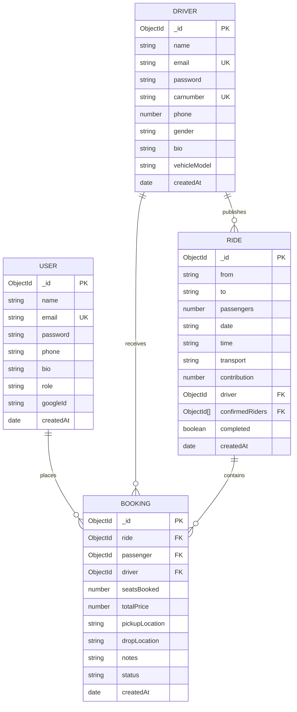

# CommuteX — Modern Community Carpooling & Shared Transit Platform

[](https://opensource.org/licenses/MIT)
[](https://nodejs.org/)
[](https://react.dev/)
[](https://vitejs.dev/)
[](https://expressjs.com/)
[](https://www.mongodb.com/)
[](https://tailwindcss.com/)

CommuteX is a full-stack, responsive carpooling platform engineered to transform urban and inter-city commutes across major Indian transit corridors into sustainable, cost-effective, and community-driven travel experiences.

---

## 1. Project Title and Introduction

**CommuteX** is a web-based community ride-sharing platform that connects vehicle owners traveling with empty seats to commuters heading along the same corridor. Built using React 19, Vite, Express, and MongoDB, CommuteX offers real-time route visualization, atomic seat allocation, driver approval workflows, and role-separated dashboards for drivers and passengers.

---

## 2. Problem Statement

Rapid urbanization and expanding metropolitan corridors (such as Delhi NCR, Chandigarh Tricity, Mumbai-Pune, and Bengaluru Tech Corridors) have resulted in:
- High vehicular congestion and prolonged daily travel times.
- Rising personal commute costs and fuel expenditure.
- Excessive carbon emissions from low-occupancy, single-commuter personal vehicles.
- Lack of transparent, reliable, non-surge cost-sharing solutions for daily inter-city travelers.

CommuteX directly addresses these challenges by enabling commuters to pool journeys safely, share fuel expenses fairly, and reduce single-occupancy vehicles on the road.

---

## 3. Project Objectives

1. **Seamless Trip Sharing**: Enable verified drivers to publish scheduled trips with custom pickup points, available seat counts, and fair contributions.
2. **Atomic Booking Lifecycle**: Guarantee overbooking prevention through atomic seat reservation and real-time inventory management.
3. **Intuitive Route Discovery**: Provide passengers with instant route search across 50+ verified cities, estimated highway distance (km), and travel duration.
4. **Empowering Dashboards**: Deliver tailored dashboard experiences for drivers (requests approval, trip management, earnings summaries) and passengers (request tracking, booking history, cancellation).
5. **Secure Architecture**: Enforce role-based access control, cryptographic password hashing, JWT authorization, and defensive request validation.

---

## 4. Key Features

- **Dynamic Identity & Branding**: Sleek dark-mode aesthetic with custom vector logo, emerald/cyan accents, and responsive typography.
- **Role-Based Authentication**: Dedicated registration, sign-in, and session management for both Drivers and Passengers.
- **Route Visualization**: Integrated RouteMap component calculating highway road distances (km), estimated durations (hours/mins), and CO₂ savings, with support for Google Maps Directions API.
- **Atomic Booking Engine**: Database-level atomic seat decrementing upon driver approval and restoration upon cancellation, preventing race conditions.
- **Driver Request Queue**: Drivers review incoming commuter requests with 1-click **Approve** and **Decline** controls.
- **Passenger Journey Tracking**: Real-time status indicators (`Pending Approval`, `Confirmed`, `Declined`, `Cancelled`) with self-service cancellation.
- **Centralized Transit Corridors**: Normalized transit data covering 50+ major Indian hubs (Delhi NCR, Chandigarh, Mumbai, Bengaluru, Hyderabad, Kolkata, Chennai, Pune, Jaipur).
- **Driver Vehicle Management**: Vehicle plate registration, model tracking, driver bio, and ride completion toggles.

---

## 5. User Roles and Workflows

### Role Comparison Matrix

| Capability | Passenger (Commuter) | Driver (Vehicle Owner) |
| :--- | :---: | :---: |
| Search Available Rides | ✅ | ✅ |
| View Route Maps & Distance | ✅ | ✅ |
| Book / Request Seats | ✅ | ❌ (Prevented by business logic) |
| Cancel Booking Request | ✅ | ✅ |
| Publish New Rides | ❌ | ✅ |
| Approve / Decline Requests | ❌ | ✅ |
| Mark Ride as Completed | ❌ | ✅ |
| View Earnings & Passengers Served | ❌ | ✅ |
| Edit Vehicle & Contact Profile | ✅ (User profile) | ✅ (Driver & Vehicle profile) |

### Passenger Workflow
```
Register/Login as Passenger 
  └─► Search Rides by From, To, Date, Transport 
        └─► Open Dedicated Ride Page (/ride/:id) 
              └─► Review RouteMap, Driver Info, Fare 
                    └─► Select Seats & Submit Booking Request (Status: Pending) 
                          └─► Track Status in Passenger Dashboard (/user-dashboard)
                                └─► Confirmed by Driver / Optional Cancellation
```

### Driver Workflow
```
Register/Login as Driver (Vehicle Plate & Model)
  └─► Access Driver Dashboard (/rider-dashboard) 
        └─► Publish Ride (/rider-dashboard/offer-ride) with Date, Time, Seats, Contribution 
              └─► Receive Real-time Passenger Booking Requests in Queue 
                    ├─► Click "Approve" (Seats atomically decremented, Status: Confirmed)
                    └─► Click "Decline" (Status: Rejected)
                          └─► Mark Trip Completed upon Arrival (/api/rides/:id/complete)
```

---

## 6. Technology Stack

### Frontend
- **Framework**: React 19.1.0 with Vite 7.1.6
- **Language**: Modern JavaScript (ES Modules)
- **Styling**: Tailwind CSS v4 & custom design tokens
- **Primitives**: Radix UI (`@radix-ui/react-avatar`, `@radix-ui/react-select`, `@radix-ui/react-popover`, `@radix-ui/react-slot`)
- **Animations**: Framer Motion 12.20.2
- **Icons**: Lucide React
- **Notifications**: Sonner (Toast notifications)
- **Routing**: React Router v7

### Backend
- **Runtime**: Node.js v18+ (ES Modules)
- **Framework**: Express.js 4.18.2
- **Database**: MongoDB with Mongoose 7.8.7
- **Authentication**: JSON Web Tokens (`jsonwebtoken`), `bcryptjs`, Passport.js Google OAuth2
- **Security & Optimization**: Helmet, Express Rate Limit, Express Mongo Sanitize, Compression

---

## 7. System Architecture

```
┌────────────────────────────────────────────────────────┐
│                   CommuteX Frontend                    │
│   (React 19 + Vite 7 + Tailwind CSS v4 + Framer Motion) │
└──────────────────────────┬─────────────────────────────┘
                           │ HTTP / JSON (REST APIs)
                           ▼
┌────────────────────────────────────────────────────────┐
│                   Express.js Backend                   │
│   ├── Security: Helmet, Rate Limiter, Mongo Sanitize   │
│   ├── Auth & Protection: JWT authMiddleware            │
│   ├── Route Handlers:                                  │
│   │   ├── /api/auth       (User Registration & Profile)│
│   │   ├── /api/driver     (Driver Auth & Profile)      │
│   │   ├── /api/rides      (Ride Creation & Inventory)  │
│   │   ├── /api/bookings   (Booking Requests & Approval)│
│   │   └── /api/contact    (Inquiries & Support)        │
└──────────────────────────┬─────────────────────────────┘
                           │ Mongoose ODM
                           ▼
┌────────────────────────────────────────────────────────┐
│                   MongoDB Database                     │
│   ├── Users Collection                                 │
│   ├── Drivers Collection                               │
│   ├── Rides Collection                                 │
│   ├── Bookings Collection                              │
│   └── Contacts Collection                              │
└────────────────────────────────────────────────────────┘
```

---

## 8. Database Schema and ER Diagram

### Entity-Relationship Diagram



---

## 9. Installation Requirements

- **Node.js**: v18.0.0 or higher
- **npm**: v9.0.0 or higher
- **MongoDB**: Local MongoDB server (listening on `mongodb://127.0.0.1:27017`) or a remote MongoDB Atlas connection URI.
- **Operating System**: Windows, macOS, or Linux.

---

## 10. Step-by-Step Installation Instructions

### 1. Clone the Repository
```bash
git clone https://github.com/Nishant-0203/carpooling.git
cd carpooling
```

### 2. Backend Setup
```bash
cd backend
npm install
```

### 3. Frontend Setup
```bash
cd ../frontend
npm install
```

---

## 11. Environment Variable Configuration

### Backend: `backend/.env`
Create a `.env` file in the `backend/` directory (referencing `backend/.env.example`):
```env
PORT=5000
NODE_ENV=development
MONGO_URI=mongodb://127.0.0.1:27017/carpooling
SESSION_SECRET=your_super_secret_session_key_2026
JWT_SECRET=your_jwt_signing_key_secure_2026
CLIENT_URL=http://localhost:5173
FRONTEND_URL=http://localhost:5173

# Optional: Google OAuth 2.0 Credentials
GOOGLE_CLIENT_ID=
GOOGLE_CLIENT_SECRET=
GOOGLE_CALLBACK_URL=http://localhost:5000/api/auth/google/callback
```

### Frontend: `frontend/.env`
Create a `.env` file in the `frontend/` directory (referencing `frontend/.env.example`):
```env
VITE_API_URL=http://localhost:5000/api
VITE_APP_NAME=CommuteX

# Optional: Google Maps JavaScript / Embed API Key
VITE_GOOGLE_MAPS_API_KEY=

# Optional: Google OAuth Client ID
VITE_GOOGLE_CLIENT_ID=
```

---

## 12. How to Run the Frontend and Backend

### Start the Backend Server
```bash
cd backend
npm run dev
# Or start directly:
# node Server.js
```
*The API server will listen on `http://localhost:5000`.*

### Start the Frontend Dev Server
In a separate terminal:
```bash
cd frontend
npm run dev
```
*The client application will launch at `http://localhost:5173`.*

---

## 13. API Documentation

### System Health
| Method | Endpoint | Access | Description |
| :--- | :--- | :--- | :--- |
| `GET` | `/` | Public | Returns API service status, health, and endpoint list |

### Passenger Authentication (`/api/auth`)
| Method | Endpoint | Access | Body Payload | Description |
| :--- | :--- | :--- | :--- | :--- |
| `POST` | `/api/auth/register` | Public | `{ name, email, password, phone }` | Registers a new passenger account and returns JWT |
| `POST` | `/api/auth/login` | Public | `{ email, password }` | Authenticates passenger credentials and returns JWT |
| `GET` | `/api/auth/profile` | Protected | None (Bearer Token) | Returns authenticated passenger profile details |
| `PUT` | `/api/auth/profile` | Protected | `{ name, phone, bio }` | Updates passenger profile information |

### Driver Authentication (`/api/driver`)
| Method | Endpoint | Access | Body Payload | Description |
| :--- | :--- | :--- | :--- | :--- |
| `POST` | `/api/driver/register` | Public | `{ name, email, password, phone, carnumber, gender }` | Registers driver account and vehicle license plate |
| `POST` | `/api/driver/login` | Public | `{ email, password }` | Authenticates driver and returns JWT |
| `GET` | `/api/driver/profile` | Protected | None (Bearer Token) | Returns driver profile, vehicle plate, and bio |
| `PUT` | `/api/driver/profile` | Protected | `{ name, phone, carnumber, bio, vehicleModel }` | Updates driver profile and vehicle details |

### Ride Management (`/api/rides`)
| Method | Endpoint | Access | Description |
| :--- | :--- | :--- | :--- |
| `POST` | `/api/rides/offer-ride` | Driver | Publishes a new offered ride with date, time, seats, and contribution |
| `GET` | `/api/rides/allRides` | Public | Fetches all active rides with populated driver details |
| `GET` | `/api/rides/:id` | Public | Retrieves detailed information for a specific ride |
| `GET` | `/api/rides/my-rides?driverId=:id` | Driver | Fetches all rides published by a specific driver |
| `PATCH` | `/api/rides/:id` | Driver | Updates ride time, pickup, destination, or contribution |
| `PATCH` | `/api/rides/:id/complete` | Driver | Marks a ride as completed |
| `DELETE` | `/api/rides/:id` | Driver | Deletes a published ride |

### Booking Management (`/api/bookings`)
| Method | Endpoint | Access | Body Payload | Description |
| :--- | :--- | :--- | :--- | :--- |
| `POST` | `/api/bookings` | Passenger | `{ rideId, seatsBooked, pickupLocation, dropLocation, notes }` | Submits a seat booking request (status: `pending`) |
| `GET` | `/api/bookings/my-bookings` | Passenger | None (Bearer Token) | Returns passenger's booking history and statuses |
| `GET` | `/api/bookings/driver-requests` | Driver | None (Bearer Token) | Returns all booking requests for driver's published rides |
| `PATCH` | `/api/bookings/:id/status` | Driver | `{ status: "confirmed" \| "rejected" }` | Approves or rejects a booking with atomic seat tracking |
| `PATCH` | `/api/bookings/:id/cancel` | Passenger / Driver | None (Bearer Token) | Cancels an existing booking and restores available seats |

---

## 14. Project Folder Structure

```
carpooling/
├── backend/
│   ├── src/
│   │   ├── config/
│   │   │   ├── db.js                 # MongoDB connection handler with error recovery
│   │   │   └── passport.js           # Google OAuth 2.0 passport strategy
│   │   ├── controllers/
│   │   │   ├── auth.controller.js     # User registration, login, and profile updates
│   │   │   ├── booking.controller.js  # Booking request lifecycle and atomic seat updates
│   │   │   ├── contact.controller.js  # Contact form submission handler
│   │   │   └── driver.controller.js   # Driver registration, login, and vehicle updates
│   │   ├── middleware/
│   │   │   ├── authMiddleware.js      # Dual User/Driver JWT protection and authorization
│   │   │   └── validation.js          # Input validation helpers
│   │   ├── models/
│   │   │   ├── booking.model.js       # Booking schema with status lifecycle & indexes
│   │   │   ├── contact.model.js       # Contact inquiry schema
│   │   │   ├── driver.model.js        # Driver and vehicle license plate schema
│   │   │   ├── offer-rides.model.js   # Ride inventory, departure, and seat schema
│   │   │   └── user.model.js          # Passenger profile and authentication schema
│   │   └── routes/
│   │       ├── auth.route.js          # User auth routes
│   │       ├── booking.route.js       # Booking request and approval routes
│   │       ├── contact.route.js       # Contact routes
│   │       ├── driver.route.js        # Driver auth routes
│   │       └── offer-ride.route.js    # Ride offering and search routes
│   ├── .env.example                  # Backend environment variable template
│   ├── package.json
│   └── Server.js                     # Express application entry point
├── frontend/
│   ├── public/
│   │   └── favicon.svg               # CommuteX custom branding favicon
│   ├── src/
│   │   ├── components/
│   │   │   ├── layout/
│   │   │   │   ├── Navbar.jsx        # Navigation bar with dynamic passenger/driver state
│   │   │   │   └── Footer.jsx        # CommuteX footer with MIT attribution
│   │   │   ├── ui/
│   │   │   │   ├── Logo.jsx          # Vector CommuteX branding component
│   │   │   │   ├── button.jsx        # Reusable Button primitive
│   │   │   │   ├── card.jsx          # Reusable Card container primitive
│   │   │   │   └── input.jsx         # Input field primitive
│   │   │   ├── ProtectedRoute.jsx    # Role-based route guard component
│   │   │   └── RouteMap.jsx          # Route visualizer with Google Maps support & distance
│   │   ├── constants/
│   │   │   └── locations.js          # Normalized list of 50+ Indian cities and transit hubs
│   │   ├── pages/
│   │   │   ├── Login/
│   │   │   │   ├── Driver-Login.jsx      # Driver portal sign-in
│   │   │   │   ├── Driver-Register.jsx   # Driver and vehicle registration
│   │   │   │   ├── DriverDashboard.jsx   # Driver control center & requests queue
│   │   │   │   ├── Role-Selection.jsx    # Choose Driver or Passenger role
│   │   │   │   ├── User-Login.jsx        # Passenger sign-in
│   │   │   │   ├── User-Register.jsx     # Passenger registration
│   │   │   │   └── UserDashboard.jsx     # Passenger bookings dashboard
│   │   │   ├── About.jsx             # About CommuteX mission
│   │   │   ├── Blog.jsx              # Commute and mobility articles
│   │   │   ├── Contact.jsx           # Support and office contacts
│   │   │   ├── Home.jsx              # Landing page
│   │   │   ├── OfferRidePage.jsx     # Publish ride form
│   │   │   ├── Ride.jsx              # Search and browse rides
│   │   │   └── RideDetailsPage.jsx   # Dedicated trip page with seat selector & booking
│   │   ├── utils/
│   │   │   ├── auth.js               # Centralized token, session, and role utilities
│   │   │   └── transit.js            # Indian highway distance & duration calculation
│   │   ├── App.jsx                   # React Router routing configuration
│   │   ├── main.jsx                  # React application entry point
│   │   └── index.css                 # Design system tokens and styles
│   ├── .env.example                  # Frontend environment variable template
│   ├── index.html                    # HTML document shell
│   ├── package.json
│   └── vite.config.js                # Vite build and server config
└── README.md
```

---

## 15. Visual Interface Architecture

```
Landing Page (/)
 ├── HeroSection (Search by Corridor, Date, Transport Mode)
 ├── TrustedBy (Key Transit Corridors: Delhi-NCR, Mumbai-Pune, Tricity, BLR-Tech)
 ├── HowItWorks (3-Step Guided Process: Search, Connect, Commute)
 ├── LiveRides (Active corridor departures with real-time seat badges)
 ├── WhyCommuteX (Smart Matching, Verified Drivers, Fair Split Fares)
 └── Testimonials (Verified commuter stories from Delhi, Bengaluru, Chandigarh)

Ride Discovery & Details (/rides & /ride/:id)
 ├── Multi-filter search (Origin, Destination, Date, Vehicle Mode)
 ├── Interactive RouteMap (Distance in km, Travel duration, CO2 avoided)
 ├── Driver Verification Card (License plate, Rating, Bio, Phone contact)
 └── Seat Reservation Widget (Dynamic seat count, Live total price, Landmark notes)

User Portals
 ├── Driver Dashboard (/rider-dashboard)
 │    ├── Overview Analytics (Total rides, pending requests, balance)
 │    ├── Passenger Request Queue (1-Click Approve / Decline actions)
 │    ├── Published Rides (Inventory tracking, complete trip toggle, delete)
 │    └── Driver Profile (Vehicle license plate, model, and bio editor)
 └── Passenger Dashboard (/user-dashboard)
      ├── Journey Stats (Confirmed trips, pending requests, total spent)
      ├── My Bookings List (Status indicators, driver contact, route notes)
      ├── Cancel Booking Modal (Atomic seat restoration)
      └── Passenger Profile (Personal info and commuter notes)
```

---

## 16. Testing Instructions

### Backend Syntax and Model Validation
Run the backend build verification:
```bash
cd backend
node --check Server.js
node --check src/models/booking.model.js
node --check src/controllers/booking.controller.js
node --check src/routes/booking.route.js
```

### Frontend Production Build Test
Verify that all 2,600+ modules and routes build with zero warnings:
```bash
cd frontend
npm run build
```
Expected output:
```
✓ 2635 modules transformed.
✓ built in ~7.60s
```

### Functional Flow Validation
1. **User Registration**: Register a passenger account at `/register` and verify redirect to `/user-dashboard`.
2. **Driver Registration**: Register a driver account with vehicle plate at `/driver-register` and verify redirect to `/rider-dashboard`.
3. **Publishing a Ride**: In driver dashboard, publish a ride (e.g. Chandigarh to Delhi, 3 seats, ₹450).
4. **Discovering & Requesting**: Sign in as a passenger, search rides at `/rides`, open `/ride/:id`, and request 2 seats.
5. **Approval & Atomic Decrement**: In driver dashboard, review the pending request under *Passenger Requests* and click *Approve Booking*. Verify remaining seats decrease to 1.
6. **Cancellation & Seat Restoration**: In passenger dashboard, cancel the booking and verify remaining seats restore to 3.

---

## 17. Security Considerations

- **Password Hashing**: Passwords are cryptographically salted and hashed using `bcryptjs` with 10 salt rounds before persistence.
- **Defensive Route Protection**: `authMiddleware.js` verifies JWT signatures, validates user existence in either User or Driver collections, and blocks unauthorized cross-role modifications.
- **Prevent Overbooking**: Seat availability checks execute atomically using Mongoose `$inc` with `$gte` query filters, eliminating race conditions.
- **HTTP Security Headers**: Integrated `helmet` sets secure Content Security Policy (CSP) and prevents clickjacking and MIME-type sniffing.
- **Rate Limiting**: Configured `express-rate-limit` mitigates brute-force attacks on sensitive authentication endpoints.
- **No Secret Exposure**: All sensitive credentials, session secrets, and database strings are confined to `.env` files and omitted from version control.

---

## 18. Future Enhancements

1. **Digital Payment Gateway**: Integrated UPI and Razorpay escrow payments with automated driver payouts upon ride completion.
2. **Live GPS Tracking**: Real-time driver location streaming via WebSockets / Socket.io for live trip tracking.
3. **In-App Messaging**: Real-time peer-to-peer chat between passenger and driver prior to pickup.
4. **Driver KYC & Document Verification**: Automated Aadhaar/Driving License verification via Digilocker API.
5. **Corporate Ridesharing**: Corporate domain matching allowing verified employees of the same company to commute together.

